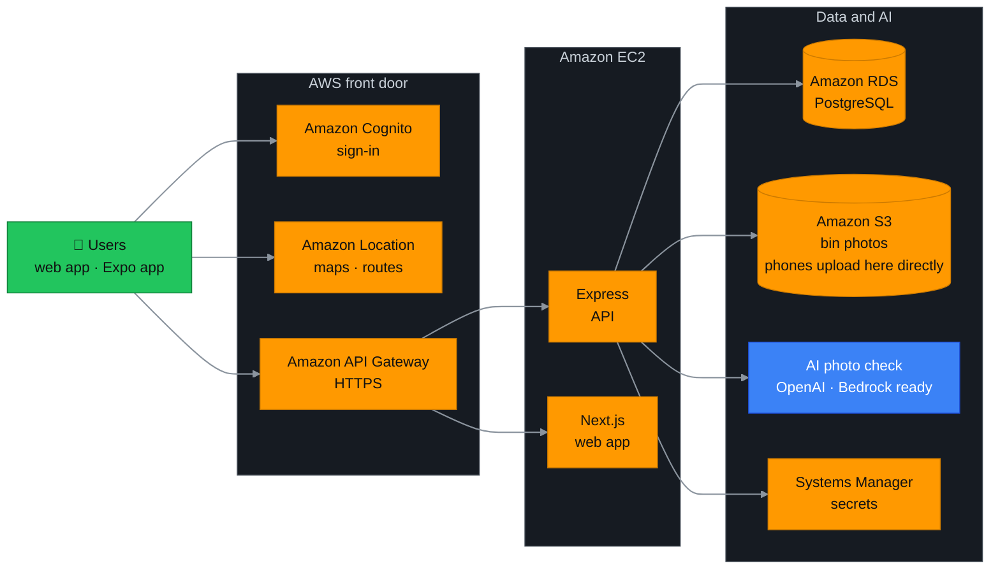
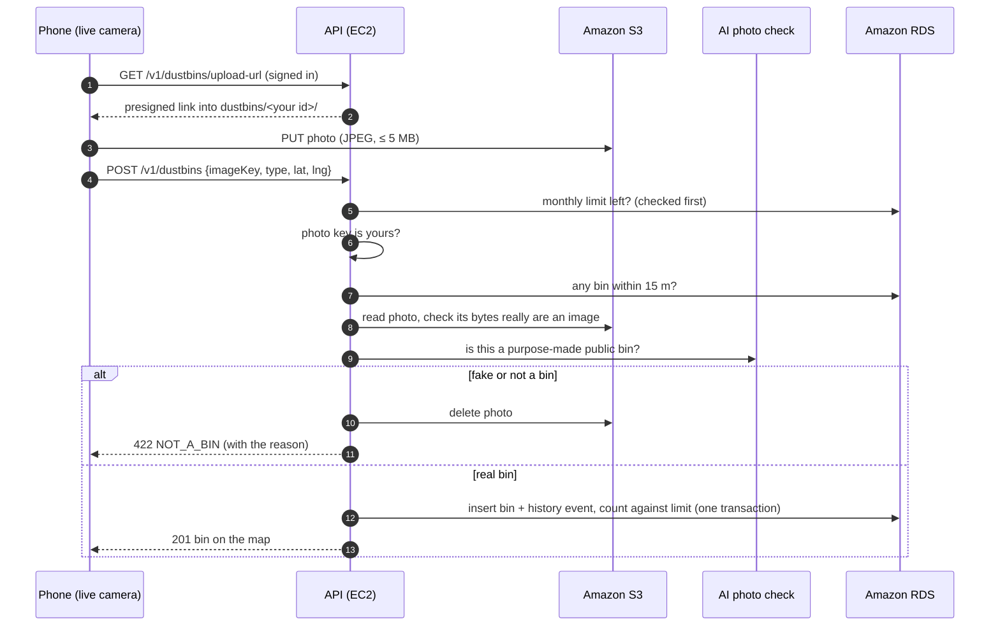

# SmartBin

**Find the nearest dustbin. Map the missing ones.**

SmartBin is a crowd-mapped directory of public dustbins for Indian cities. People find the nearest bin and walk to it. Anyone can add a bin with a live photo, and an AI check plus eight other layers keep fake bins off the map. City and campus teams get a dashboard of where bins are full, broken, missing, or needed.

Built for the **WeMakeDevs × AWS Environmental Hacks** (Waste & Energy track, October 2026).

| | |
|---|---|
| **Live app** | https://l60qdgkh8a.execute-api.ap-south-1.amazonaws.com |
| **AI evaluation (public)** | https://l60qdgkh8a.execute-api.ap-south-1.amazonaws.com/evals |
| **Admin dashboard** | https://l60qdgkh8a.execute-api.ap-south-1.amazonaws.com/admin (demo admin accounts are in our submission) |
| **Mobile app** | Separate repo, `Smartbin-Mobile` (Expo) |

---

## The problem

- **People litter because they can't find a bin.** Public dustbins in Indian cities exist, but nobody knows where they are. Maps don't show them, and a bin two streets away might as well not exist.
- **Bins go missing, overflow or break, and nobody hears about it.** Municipal teams find out late, if at all, and residents have no simple way to tell them.
- **Wet and dry waste get mixed.** Many places have separate green (wet) and blue (dry) bins, but people don't know which is which or where the right one is.
- **Cities don't know where new bins are needed.** There's no data on where people look for a bin and don't find one.
- **Crowd-sourced maps attract junk.** If anyone can add a "bin", people add buckets, post boxes, garbage piles and photos from the internet, and the map stops being trustworthy.

## What SmartBin does

**For everyone (web and mobile)**
- A map of nearby bins with wet/dry type, distance and **walking directions**.
- **Add a bin** in under a minute: drop a pin, take a **live photo** (no gallery uploads), pick wet, dry or both. The AI checks the photo before the bin goes on the map.
- **Report a problem:** full, broken, dirty, or missing. Missing reports need you to be within 20 m of the bin, and a bin is removed after enough reports (3 by default).
- Monthly limits per person, so one account can't flood the map.

**For city and campus teams (admin dashboard)**
- Overview charts: new bins, reports, removals, users, and daily trends.
- **Demand map:** where bins are used most, and **where people search but find no bin**, which is where new bins are needed.
- **Cleaning queue:** bins reported full, broken or dirty, with one-click "sorted".
- Bin table with filters, the full history of each bin, users, an activity feed, and **settings** (limits and thresholds) that change without a redeploy.

**Demo mode:** with `DEMO_MODE=true`, opening the map anywhere in India where there are few bins nearby creates a dozen clearly labelled **"Demo"** bins around that spot (with photos and some history), so the app and the dashboard are never empty. They are flagged in the database, ignored by real registrations, and removed with one command.

**For judges: `/evals`**, a public page showing how well the AI tells real bins from fakes, with every test photo, the model's verdict and its reason, a live re-run, and a box to try your own photo.

---

## Architecture

Users sign in with Cognito, load maps from Amazon Location, and talk to one HTTPS address (API Gateway), which sends API calls and pages to the server. Only the API touches the database, the photos, the AI and the secrets.



**Key design choices**
- **Photos never pass through the API.** The phone uploads straight to S3 with a 5-minute presigned link, into a folder that belongs to that user. The API then reads the photo from S3 to check it. The bucket is private, and photos are shown through short-lived signed links.
- **One HTTPS address for everything.** API Gateway sends `/v1/*` to the API and everything else to the web app. That gives free HTTPS (required for the camera and for phones) without buying a domain, plus a rate limit.
- **No secrets on the server.** The EC2 instance uses an IAM role. The database password and AI key sit encrypted in Parameter Store, and the server was deployed through Systems Manager with SSH closed.
- **Every AWS service has a fallback.** Maps and routes fall back to OpenStreetMap services if Amazon Location fails. The photo check runs on OpenAI and switches to Bedrock with one setting.

### Adding a bin, step by step



---

## AWS services

| Service | What it does for SmartBin |
|---|---|
| **Amazon Cognito** | Sign-up with an emailed code, sign-in, and the `ADMIN` group for the dashboard. The API verifies every access token |
| **Amazon API Gateway** | The public HTTPS address for the web app and API, with a rate limit of 50 requests/second |
| **Amazon EC2** | Runs the API and the web app (t3.small, kept running by pm2) |
| **Amazon RDS for PostgreSQL** | Bins, users, reports, history, quotas, settings and evaluation runs (private, encrypted) |
| **Amazon S3** | Bin photos. Phones upload directly and the bucket stays private |
| **Amazon Location Service** | Map tiles (with India's official borders) and walking routes to a bin |
| **AWS IAM** | The server's role: S3, its own secrets, deployments. No access keys on the server |
| **AWS Systems Manager** | Parameter Store holds the encrypted secrets; Run Command deploys the server with no SSH |
| **AWS KMS** | Encrypts the secrets, the database and the server's disk |
| **Amazon VPC** | Firewalls: the database only accepts connections from the app server |
| **Amazon EBS** | The server's encrypted disk |
| **Amazon Bedrock** | Built in as the photo-check provider (Nova Lite). Waiting for the account to be enabled; the switch is one setting |

---

## Keeping fake bins off the map

A bin only reaches the map after **nine layers**, all enforced by the API, so skipping the app doesn't skip them:

| # | Layer | What it stops |
|---|---|---|
| 1 | **Sign-in required** (Cognito) | Anonymous spam |
| 2 | **Live camera only** in the app | Gallery uploads, old or downloaded photos |
| 3 | **Upload links only for JPEG, PNG or WebP**, for 5 minutes, into your own folder | Other file types; writing into someone else's folder |
| 4 | **The photo must be yours** | Reusing another person's upload |
| 5 | **The file must really be an image**, checked from its bytes, not its claimed type | A text file renamed `.jpg` (deleted on the spot) |
| 6 | **AI check:** only a *purpose-made bin in a public place* passes, enforced in code from the model's structured answer | Buckets, post boxes, hydrants, barrels, garbage piles and bags, drawings (photo deleted) |
| 7 | **No other bin within 15 m** | The same bin registered twice |
| 8 | **Monthly limit per person**, set by admins; only accepted bins count | Bulk registration from one account |
| 9 | **Missing reports only from within 20 m**, and limited per month | Removing real bins from home |

**Proof:** `npm run test:anti-fake` tries every one of these through the real API, with real sign-ins, S3 and the AI. Latest result: **15 of 15 checks passed.** Details, results and known limits are in [docs/anti-fake.md](docs/anti-fake.md).

---

## AI evaluation

The photo check is tested on a **labelled set of 20 photos** from Wikimedia Commons, each label checked by hand. There are **8 real dustbins**, including 2 genuinely borderline "hard" cases, and **12 non-dustbins chosen to trick the model**: a plastic bucket, a dirty bucket, a red post box, a fire hydrant, an old barrel, a black bag full of rubbish, two garbage dumps, and four unrelated scenes.

**Latest result (gpt-4.1-mini, run on production):**

| Metric | Result |
|---|---|
| Fakes blocked | **12 / 12** (0 got through) |
| Clear dustbins accepted | **6 / 6** |
| Overall accuracy | **19 / 20 (95%)** |
| Time per photo | about 1.2 s |
| Stability | Same result on every run since the final rule (3 runs in a row locally, plus production) |

**See it, rerun it, try to break it:**
- **[`/evals`](https://l60qdgkh8a.execute-api.ap-south-1.amazonaws.com/evals)** shows every test photo with the model's verdict, confidence and reason, and the latest run's numbers. Admins can **re-run the whole set live** (about 6 s), and anyone signed in can **try their own photo** (deleted after the check).
- `cd apps/api && npm run eval:vision` runs the same evaluation from the command line and saves the run. It **fails if any fake is accepted** or a clear dustbin is rejected.

**What we learned, and the trade-off we chose:** our first rule let the model accept "improvised" bins (drums, barrels) when it saw waste in them. It then *imagined* a bin liner in an empty barrel and accepted a bag of rubbish. So the model now only describes what kind of object it sees and where, and the code decides: only a purpose-made bin standing in a public place passes. **The cost:** a real bamboo basket bin from Assam is now rejected. It stays in the set as a hard case, and we show it on `/evals` rather than hide it.

**Known limits:** one clear photo of a real bin passes wherever it was taken, and phone GPS can be faked. That's why the AI is backed by the live camera, the 15 m and 20 m rules and the monthly limits.

---

## Tech stack

- **Web:** Next.js 16, React 19, Tailwind CSS 4, shadcn/ui, MapLibre GL, Recharts, Motion, AWS Amplify (auth)
- **API:** Node.js, Express, TypeScript, Zod, Drizzle ORM, AWS SDK v3, `aws-jwt-verify`, OpenAI SDK
- **Data:** PostgreSQL 16 (Amazon RDS)
- **Mobile:** Expo (separate repo)

## Repository layout

```
apps/api          Express API: auth, bins, reports, admin, settings, AI checks, evaluations
  scripts/        eval-vision, test-anti-fake, seed-demo
apps/web          Next.js: landing page, map app (/app), admin dashboard (/admin), AI evaluation (/evals)
  public/evals/   the evaluation photos and their credits
packages/db       Drizzle schema and database client
docs/             api.md (API reference), anti-fake.md (fake-bin defences, tests and results)
```

## Run it locally

```sh
docker compose up -d                          # Postgres on localhost:15432
cd packages/db && npm install && npx drizzle-kit push
cd ../../apps/api && npm install
cp .env.example .env                          # Cognito, S3 and OpenAI values (or the local-only modes below)
npm run dev                                   # API on http://localhost:3000/v1/health
cd ../web && npm install && npm run dev       # web on http://localhost:3001 (reads the root .env; see .env.example)
```

**No AWS account?** In `apps/api/.env`, set `AUTH_MODE=dev`, `STORAGE_MODE=local` and `VISION_PROVIDER=off`, and in the root `.env` set `NEXT_PUBLIC_AUTH_MODE=dev`. Sign-in becomes email-only, photos stay on disk, and the AI check is skipped. The API refuses to start in production with any of these.

**Useful scripts** (in `apps/api`):

| Command | What it does |
|---|---|
| `npm run eval:vision` | AI evaluation on the 20 labelled photos; saves the run for `/evals` |
| `npm run test:anti-fake` | Tries every way to sneak in a fake bin through the API (15 checks) |
| `npm run seed:demo` | About 60 demo bins around Delhi with six weeks of activity; `-- --reset` removes them |

## Documentation

- [docs/api.md](docs/api.md): API reference for the web and mobile apps
- [docs/anti-fake.md](docs/anti-fake.md): fake-bin defences, test results and limits
- [apps/web/DESIGN.md](apps/web/DESIGN.md) and [apps/web/FLOWS.md](apps/web/FLOWS.md): design system and user flows
- [.claude/rules/aws-handoff.md](.claude/rules/aws-handoff.md): what runs locally and which AWS service replaces it

---

## Contributors

| | Worked on |
|---|---|
| **Satya Sootar** | Web app and design: landing page, the map app (find, add and report bins, walking directions), the admin dashboard (overview, demand map, cleaning queue, bins, activity, users, settings), problem reports, usage and demand analytics, demo data |
| **Karan Kumar** | API and AWS: bin rules and quotas, Cognito sign-in, S3 photo pipeline, AI photo check, fake-bin defences, AI evaluation and the `/evals` page, admin API, AWS deployment (EC2, RDS, API Gateway, Location, Parameter Store) |
| **Dhirender Choudhary** | Project setup: the GitHub repository and the Next.js and Drizzle foundation |
| **Sudo** | Reviewed the code and helped produce the demo video |

Demo photos on `/evals`: Wikimedia Commons contributors, credited in [apps/web/public/evals/CREDITS.md](apps/web/public/evals/CREDITS.md).
