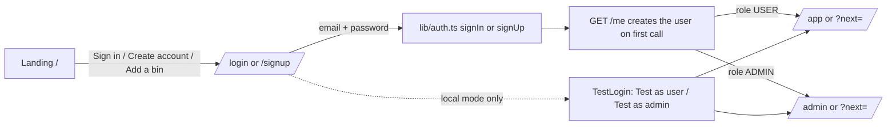
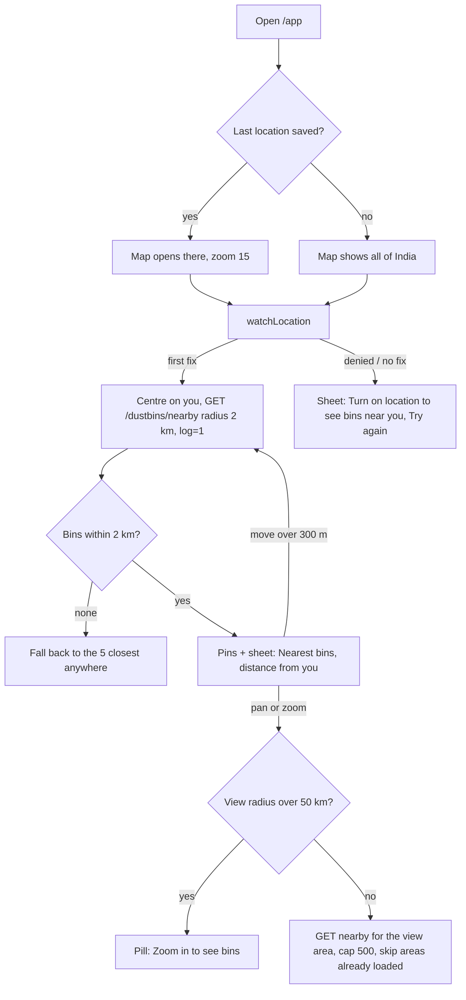
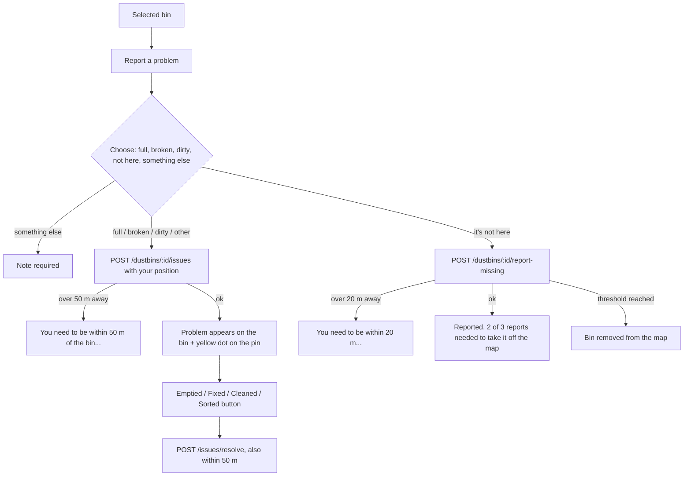
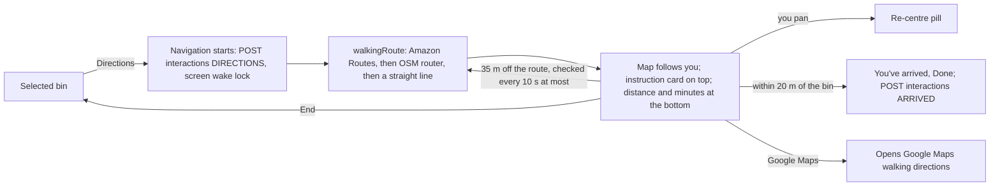
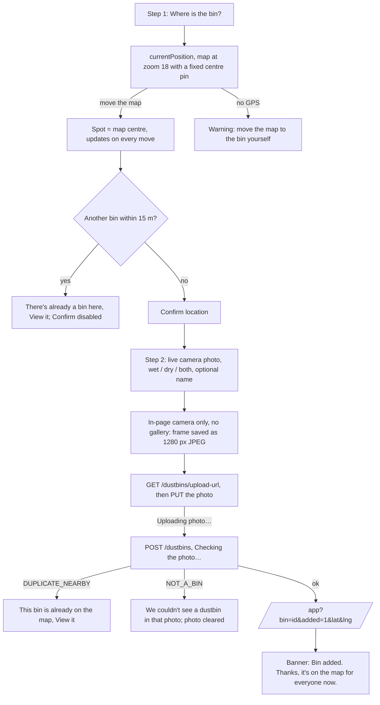
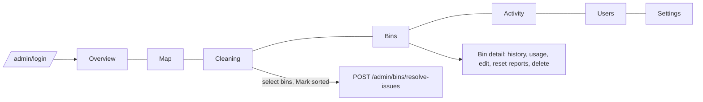

# SmartBin web: screens and flows

Who uses what, and what happens at each step. The design rules are in `DESIGN.md`, and the API behind every step is in `../../docs/api.md`. The Expo app has the same user flows (its `FLOWS.md`), plus a route preview before navigation starts.

## Routes

| Route | Who | Screen | Main file |
|---|---|---|---|
| `/` | Everyone | Landing page | `src/app/page.tsx` |
| `/login`, `/signup` | Everyone | Sign in / create account | `src/components/AuthForm.tsx` |
| `/admin/login` | Admins | Admin sign in | `AuthForm mode="admin"` |
| `/privacy` | Everyone | Privacy policy | `src/app/privacy/page.tsx` |
| `/app` | Signed in | Map: nearby bins, bin sheet, navigation | `src/app/app/page.tsx` |
| `/app/add` | Signed in | Add a bin (2 steps) | `src/app/app/add/page.tsx` |
| `/app/me` | Signed in | Account | `src/app/app/me/page.tsx` |
| `/admin` | Admins | Overview (charts, insights) | `src/app/admin/page.tsx` |
| `/admin/map` | Admins | All bins and search demand on a map | `src/app/admin/map/page.tsx` |
| `/admin/cleaning` | Admins | Cleaning queue | `src/app/admin/cleaning/page.tsx` |
| `/admin/bins`, `/admin/bins/[id]` | Admins | Bin table, one bin's history and controls | `src/app/admin/bins/` |
| `/admin/activity` | Admins | Event feed | `src/app/admin/activity/page.tsx` |
| `/admin/users` | Admins | Users | `src/app/admin/users/page.tsx` |
| `/admin/settings` | Admins | Limits and rules | `src/app/admin/settings/page.tsx` |

**Guards:** `src/app/app/layout.tsx` and `src/app/admin/layout.tsx` wrap pages in `AuthGate`. With no token it sends you to `/login?next=…` (or `/admin/login`). It then calls `GET /me` and blocks non-admins from `/admin` with "This account doesn't have admin access". This is only a client-side guard: **the API enforces roles itself.** `useMe()` gives pages the signed-in user.

## Sign in

- `?next=` only accepts same-site paths (`/…`, not `//…`).
- On `/admin/login` the account must be an admin. Otherwise it signs straight out with an error.
- **Local mode** (`NEXT_PUBLIC_AUTH_MODE=dev`): any password works and the token is the email. `TestLogin` shows one-tap buttons for `demo@smartbin.local` and `admin@smartbin.local`, on the auth pages and in the account page's "Testing" card. **With Cognito this all goes away** (see `.claude/rules/aws-handoff.md` at the repo root).

## Find a bin (`/app`)

- Bins from every load are merged by id. Distances are recalculated from your live position and sorted nearest first. The sheet lists the 25 nearest.
- Filter chips: **All / Wet / Dry** (`?type=WET` from the landing page preselects one). "Wet" also shows bins that take both.
- Tapping a pin or a list row selects the bin (`POST /interactions VIEW`), and the map pans it into view above the sheet.
- The sheet handle collapses the sheet to one line (swipe down or tap) and opens it again (swipe up or tap). Selecting a bin reopens it.
- Your last position is kept in `localStorage["smartbin.lastLocation"]` (this device only).
- `/app?bin=<id>` opens with that bin selected.

### Selected bin

Shows the photo, name, waste type badges, "N people reported it missing", open problems, distance and walking minutes, plus **Directions** and **Report a problem**.

## Report a problem / mark it sorted

- Problems are listed one per type, with "Reported 5 minutes ago, by 3 people". An "Other" problem shows its note.
- A "full" report closes itself after `fullIssueHours` (admin setting, default 24 h) if nobody marks the bin emptied.
- Missing reports count against the monthly quota (default 15). After `missingReportsThreshold` (default 3) the bin is removed, and admins keep its history.
- Your position comes from the live location the map already has; it only waits for a fresh GPS fix if there isn't one yet.

## Directions

- On the web, navigation starts straight away. The Expo app adds a route preview with **Start** and a heading-up, tilted camera; bringing that to the web is an open request.
- If routing fails, a straight line is drawn with "Walking routes are unavailable right now, so this is a straight line."

## Add a bin (`/app/add`)

- The map screen fetches the new bin around `lat`/`lng` (it may be outside the area loaded around you), selects it, and replaces the URL with `/app?bin=<id>` so a refresh doesn't show the banner again.
- If the pin is over 100 m from you: "The pin is 350 m from you. Make sure it's on the right bin."
- Registrations count against the monthly quota (default 10). Only successful ones count.

## Get the app

The header's **Get the app** pill (from `md` up) and the footer link go to `/#get-the-app` on the landing page. The Google Play and App Store buttons there read `SITE.appLinks` in `src/lib/site.ts`. While a link is empty, its button says "Coming soon" and does nothing; paste the store URL there once the app is published. "Use SmartBin in your browser" goes to `/app`.

## Account (`/app/me`)

Shows your email and role, **This month** (bins added and missing reports left, and the reset date from `GET /me/quota`), **Appearance** (Light / Dark / System), **Testing** (local mode only) and **Sign out**, which goes back to `/`.

## Admin

| Page | What admins do there | API |
|---|---|---|
| Overview | Pick a range. Searches, opens and directions per day; most wanted bins; bin health; fastest to fill; full reports by hour (IST); problems by type; slowest to sort; map growth | `/admin/stats`, `/admin/stats/timeseries`, `/admin/insights` |
| Map | Every bin coloured by its worst problem; filters All / Need attention / May be missing; search-demand heatmap; select a bin for a summary | `/admin/bins/map`, `/admin/demand` |
| Cleaning | Bins with open problems, most urgent first (more reports, waiting longer, busier); mark one or many sorted | `/admin/cleaning`, `/admin/bins/resolve-issues` |
| Bins → detail | Search and filter the table; open a bin for its photo, map spot, events, usage; edit name/type, reset reports, delete | `/admin/bins`, `/admin/bins/:id` |
| Activity | Everything that happened to bins, newest first, including removed bins | `/admin/events` |
| Users | Everyone who signed in, with what they added and reported | `/admin/users` |
| Settings | Monthly limits, the missing-report threshold, how long "full" stays open; history of changes. Changes apply immediately | `/admin/settings` |

## States every screen handles

| State | What people see |
|---|---|
| Loading | `Spinner` with a message ("Finding bins near you…") or `Skeleton` rows; maps show the `bg-map` colour |
| Location off | "Location is turned off for SmartBin. Allow location in your browser settings, then try again." with **Try again** |
| No bins | "No bins mapped here yet" and an invitation to add one |
| API unreachable | "Can't reach SmartBin. Check your connection and try again." |
| Signed out mid-session (401) | `api()` signs out and `AuthGate` sends you to sign in |
| Map tiles fail | `createMap` switches from Amazon to OpenFreeMap by itself |

## Tracking (for admin stats)

`trackInteraction` (VIEW, DIRECTIONS, ARRIVED) is best effort and never blocks the UI. The API dedupes it per user and bin. A "bins near me" search is logged only on the first load around you (`log=1`), not on map pans. The API stores searches as rounded ~100 m cells with no user id.
