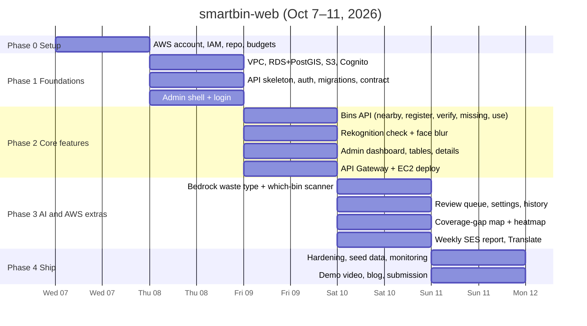
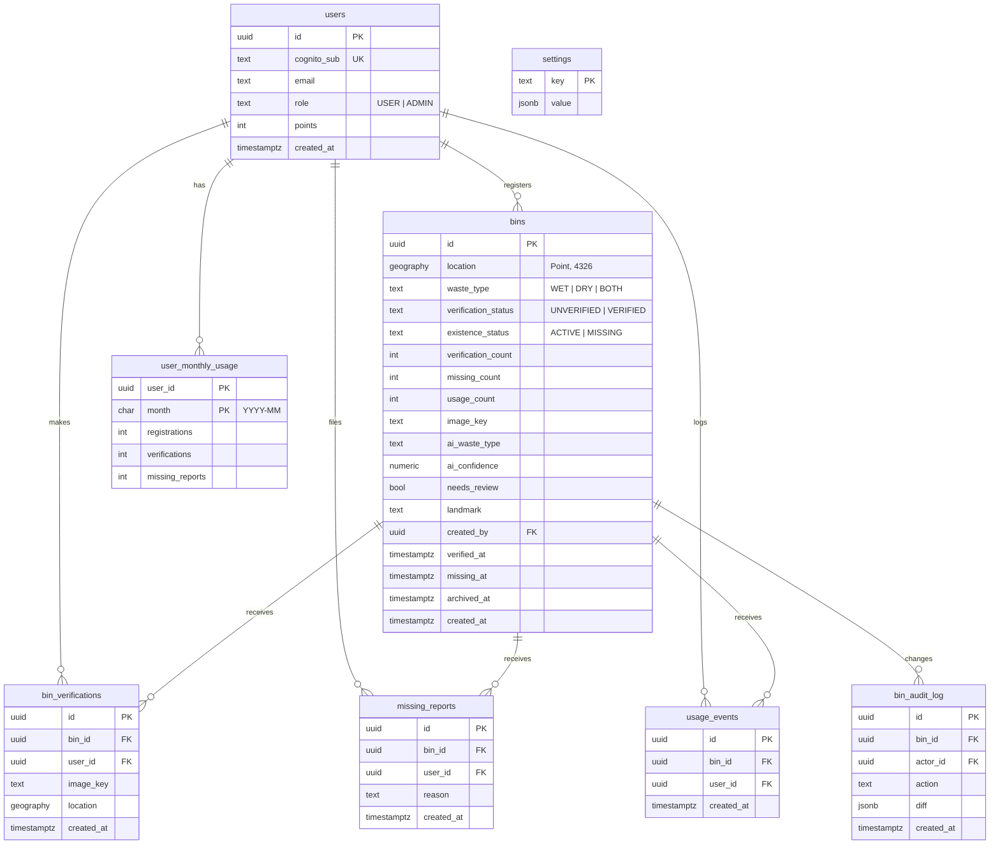
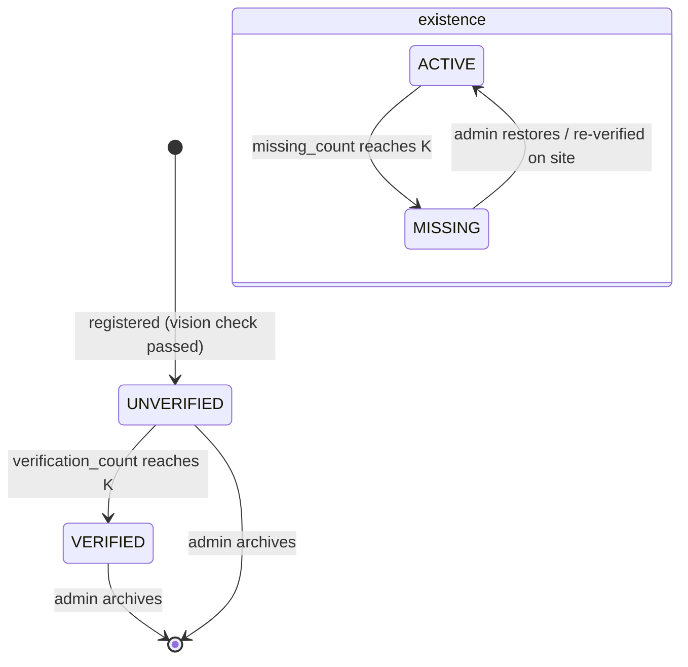
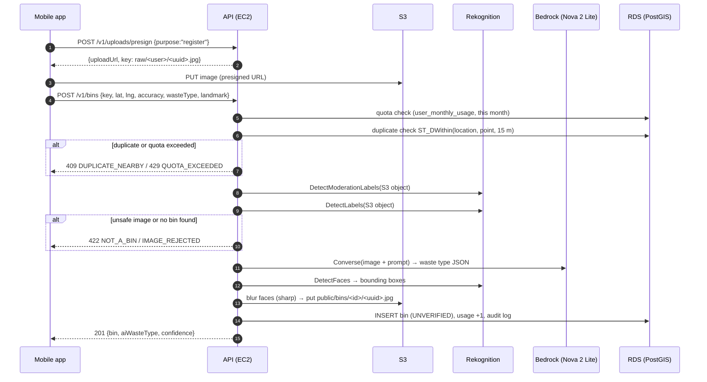

# SmartBin Web Repository: Phase-by-Phase Project Plan

**Repository:** `smartbin-web`
**Hackathon:** WeMakeDevs × AWS Environmental Hacks, Waste & Energy track, **Oct 8–11, 2026**
**Companion document:** [`plan-app-repo.md`](./plan-app-repo.md) (the Expo mobile app)
**Feature source:** [`aws-feature-plan.md`](./aws-feature-plan.md) and the team PRD

> **Assumption about the two repositories.** The mobile app lives in `smartbin-app`. Everything else lives here: the **Node.js API** that both clients call, the **React admin dashboard**, and the **AWS infrastructure** scripts. The API serves both clients, so keeping it next to the admin web makes the shared API contract easy to maintain. If you would rather put the API in its own repo later, the `api/` folder moves out unchanged.

---

## Who does what in this repo

| Person | Role in `smartbin-web` | Folders they own |
|---|---|---|
| **Dhirender** | AWS account, IAM, networking, RDS, S3/CloudFront, Cognito, API Gateway, Amplify Hosting, CI/CD, secrets, monitoring | `infra/`, `.github/workflows/`, `api/deploy/` |
| **Karan** | API: auth middleware, bins CRUD, geo queries, quotas, verification/missing logic, Rekognition + Bedrock integration | `api/src/` |
| **Sudo** | Admin API routes and the admin dashboard features: stats, tables, history, review queue, settings, coverage map, weekly report | `api/src/routes/admin/`, `admin/src/features/` |
| **Satya** | Admin dashboard shell, design system, map components, login UI (shared patterns with the mobile app) | `admin/src/components/`, `admin/src/app/` |

Throughout this document every task carries an owner tag, for example **👤 Karan**. A task with two names means the first person leads and the second reviews or helps.

---

## 1. Architecture

```mermaid
flowchart LR
    subgraph Clients
        APP["📱 Expo app<br/>(smartbin-app)"]
        ADMIN["🖥️ Admin web<br/>React + Vite<br/>on Amplify Hosting"]
    end

    COG["Amazon Cognito<br/>User pool<br/>groups: USER, ADMIN"]
    APIGW["Amazon API Gateway<br/>HTTP API<br/>(HTTPS + JWT check)"]

    subgraph VPC["VPC (ap-south-1)"]
        EC2["EC2: Node.js / Express API<br/>(pm2)"]
        RDS[("RDS PostgreSQL<br/>+ PostGIS")]
    end

    S3[("S3 bucket<br/>raw + public images")]
    CF["CloudFront<br/>image CDN"]
    REK["Amazon Rekognition<br/>labels, moderation, faces"]
    BR["Amazon Bedrock<br/>Nova 2 Lite"]
    LOC["Amazon Location Service<br/>Maps · Places · Routes"]
    TR["Amazon Translate"]
    SM["Secrets Manager"]
    EB["EventBridge Scheduler"]
    LAM["Lambda: weekly report"]
    SES["Amazon SES"]
    CW["CloudWatch<br/>logs, metrics, alarms"]

    APP -- sign in --> COG
    ADMIN -- sign in --> COG
    APP -- REST + JWT --> APIGW
    ADMIN -- REST + JWT --> APIGW
    APIGW --> EC2
    EC2 --> RDS
    EC2 --> S3
    APP -- presigned PUT --> S3
    S3 --> CF --> APP
    CF --> ADMIN
    EC2 --> REK
    EC2 --> BR
    EC2 --> LOC
    EC2 --> TR
    EC2 --> SM
    APP -- map tiles (API key) --> LOC
    ADMIN -- map tiles (API key) --> LOC
    EB --> LAM --> SES
    LAM --> RDS
    EC2 --> CW
```



**Why this shape**
- **One region, `ap-south-1` (Mumbai).** Amazon Location Service (Maps, Places, Routes), Rekognition, Cognito, RDS and Bedrock are all usable there. Nova 2 Lite runs in Mumbai through the **global cross-region inference profile** `global.amazon.nova-2-lite-v1:0`. Low latency for Indian users.
- **API Gateway HTTP API in front of EC2** gives HTTPS without buying a domain or setting up certificates. Mobile apps need HTTPS: Android blocks cleartext HTTP by default and iOS requires it. It also lets Cognito tokens be checked before requests reach the server.
- **EC2 stays** as in the PRD. Do not plan on AWS App Runner: AWS has closed it to new customers and points to **ECS Express Mode** instead. Moving to ECS later is optional.
- **Images never pass through the API.** The app uploads straight to S3 with a presigned URL. The API then asks Rekognition to read the image directly from S3.

---

## 2. Repository layout

```
smartbin-web/
├── api/                         # Node.js + Express + TypeScript       👤 Karan
│   ├── src/
│   │   ├── index.ts             # app bootstrap
│   │   ├── config.ts            # env + Secrets Manager loading      👤 Dhirender
│   │   ├── db/                  # pg pool, migrations, seed
│   │   ├── auth/                # Cognito JWT verify, role guard
│   │   ├── routes/
│   │   │   ├── bins.ts          # nearby, detail, register, verify, missing, use, edit
│   │   │   ├── uploads.ts       # presigned S3 URLs
│   │   │   ├── ai.ts            # "which bin?" scanner
│   │   │   ├── places.ts        # Location Places + Routes proxy
│   │   │   ├── me.ts            # quota, profile
│   │   │   └── admin/           # stats, tables, history, review, settings   👤 Sudo
│   │   ├── services/
│   │   │   ├── rekognition.ts
│   │   │   ├── bedrock.ts
│   │   │   ├── images.ts        # face blur with sharp, copy raw → public
│   │   │   ├── location.ts
│   │   │   └── quota.ts
│   │   └── lib/                 # errors, logger (pino), validation (zod)
│   ├── migrations/              # SQL files (node-pg-migrate)
│   ├── deploy/                  # pm2 ecosystem file, deploy script  👤 Dhirender
│   └── package.json
├── admin/                       # React + Vite + TypeScript          👤 Sudo, Satya
│   ├── src/
│   │   ├── app/                 # router, layout, auth gate
│   │   ├── components/          # shared UI, map, charts
│   │   ├── features/            # dashboard, bins, review, settings, coverage
│   │   └── lib/api.ts           # typed API client
│   └── package.json
├── lambdas/
│   └── weekly-report/           # EventBridge → Lambda → SES          👤 Sudo
├── infra/                       # setup scripts / CDK (optional)       👤 Dhirender
├── docs/
│   ├── api.md                   # THE API CONTRACT shared with smartbin-app
│   └── architecture.png         # for the demo video
└── .github/workflows/           # CI + deploy                         👤 Dhirender
```

**Branching:** `main` is protected and deployable. Work on `feat/<name>` branches, open a PR, one teammate approves. Dhirender sets this up in Phase 0.

---

## 3. Timeline at a glance



Saturday Oct 10 is the optional in-person build day at DTU, Delhi. Phase 3 is planned for that day so the team can sit together for the integration work.

**Golden rule:** if Phase 2 is not working end to end by Friday night, skip Phase 3 extras and go straight to Phase 4. A working app beats a long service list ("Execution" is a judging criterion).

---

## Phase 0: Setup (Tonight, Oct 7)

**Goal:** everyone can run the code and the AWS account is safe to use.

| # | Task | Owner | Done when |
|---|---|---|---|
| 0.1 | Create the AWS account (or use a student one); turn on MFA for root; create an IAM Identity Center or IAM user per teammate with admin access for the hackathon | 👤 Dhirender | Each teammate can sign in to the console |
| 0.2 | **AWS Budgets** alert at $10 and $25 to the team email | 👤 Dhirender | Alert emails confirmed |
| 0.3 | Request the extra $25 team credit through the hackathon form (team leader submits) | 👤 Dhirender | Form submitted |
| 0.4 | Pick region **ap-south-1**; in the Bedrock console open **Model access** and make sure Amazon Nova models are available | 👤 Dhirender | A test prompt runs in the Bedrock playground |
| 0.5 | Create `smartbin-web` on GitHub, protect `main`, add the folder layout above, add `.editorconfig`, Prettier, ESLint, a `README` with run steps | 👤 Dhirender | Teammates can clone and run `npm install` |
| 0.6 | Write the first draft of `docs/api.md` (endpoints in section 6 below) so app and admin can start against it | 👤 Karan, Satya | Both repos agree on request/response shapes |
| 0.7 | Every teammate verifies student status on **AWS Builder Center** (needed for rewards and the blog) | 👤 Everyone | Profiles verified |

---

## Phase 1: Foundations (Day 1, Thu Oct 8)

**Goal:** a database with the right schema, a running API that knows who the user is, and an admin site where an admin can log in.

### 1A. AWS infrastructure  👤 Dhirender

1. **Networking.** Use the default VPC for speed. Create two security groups:
   - `sg-api` (EC2): inbound 3000 only from anywhere for now (API Gateway calls the public DNS), inbound 22 from your IP only, or use **Session Manager** and skip SSH entirely.
   - `sg-db` (RDS): inbound 5432 **only from `sg-api`**.
2. **RDS PostgreSQL.** Engine PostgreSQL 16+, `db.t4g.micro`, 20 GB gp3, **not publicly accessible**, in `sg-db`. Store the master password in **Secrets Manager** (RDS can manage it for you). Then from the EC2 box:
   ```sql
   CREATE EXTENSION IF NOT EXISTS postgis;
   CREATE EXTENSION IF NOT EXISTS pgcrypto;  -- gen_random_uuid()
   ```
3. **S3 bucket** `smartbin-images-<random>`:
   - Block all public access.
   - Prefixes: `raw/` (uploads from phones, not public) and `public/` (processed images shown in the app).
   - **Lifecycle rule:** delete objects under `raw/` after 7 days.
   - **CORS** allowing `PUT` from any origin (the app uploads with presigned URLs).
4. **CloudFront distribution** with the bucket as origin using **Origin Access Control**, restricted to the `public/` path. The app shows images from `https://<dist>.cloudfront.net/public/...`.
5. **Cognito user pool** `smartbin-users`:
   - Sign-in with **email**. Self sign-up on. Email verification by code.
   - Groups: `USER`, `ADMIN`. Add a **post-confirmation Lambda** (small, 10 lines) that adds every new user to `USER`. Admins are added to `ADMIN` by hand in the console.
   - Two app clients with **no client secret**: `mobile-app` and `admin-web`. Enable `ALLOW_USER_SRP_AUTH` and `ALLOW_REFRESH_TOKEN_AUTH`.
   - Email sending: the built-in Cognito email sender has a small daily limit. That is enough for a demo; switch to SES only if you expect many sign-ups.
   - Skip phone/SMS sign-in: sending SMS to Indian numbers requires DLT sender registration, which will not happen within the hackathon.
6. **EC2** `t3.small` (or `t4g.small`), Amazon Linux 2023, in `sg-api`, with an **IAM instance role** `smartbin-api-role` that allows:
   - `s3:GetObject`, `s3:PutObject`, `s3:DeleteObject` on the bucket
   - `rekognition:DetectLabels`, `rekognition:DetectModerationLabels`, `rekognition:DetectFaces`
   - `bedrock:InvokeModel` on the Nova 2 Lite inference profile and foundation model
   - `geo-places:SearchText`, `geo-places:SearchNearby`, `geo-places:Autocomplete`, `geo-routes:CalculateRoutes`
   - `translate:TranslateText`
   - `secretsmanager:GetSecretValue` on the DB secret
   - `CloudWatchAgentServerPolicy` and `AmazonSSMManagedInstanceCore` (managed policies)
   Install Node.js LTS, `pm2`, and the CloudWatch agent.
7. **Amazon Location API key** `smartbin-maps-key` with only `geo-maps:GetStaticMap`, `geo-maps:GetTile` (maps) actions. Restrict referrers to the admin domain once Amplify gives you a URL. The mobile app uses the same key for map tiles only; Places and Routes go through the API so their keys never ship in the app.

> **Done when:** Karan can connect to RDS from the EC2 box with `psql`, and Dhirender has shared a `.env.example` with all IDs (user pool ID, client IDs, bucket, CloudFront domain, region, map key).

### 1B. Database schema  👤 Karan



Key details:
- `bins.location geography(Point,4326)` with a **GiST index**: `CREATE INDEX bins_location_gix ON bins USING GIST (location);`
- **Two separate states**, as in the PRD: `verification_status` (UNVERIFIED → VERIFIED) and `existence_status` (ACTIVE → MISSING). The app shows both.
- `UNIQUE (bin_id, user_id)` on `bin_verifications` and `missing_reports` enforces "one verification / one report per user per bin".
- **Monthly quotas without a reset job.** `user_monthly_usage` is keyed by `(user_id, month)`. A new month simply starts a new row at zero, so no cron is needed.
- `settings` holds `verify_threshold_k`, `missing_threshold_k`, `duplicate_radius_m` (15), `verify_max_distance_m` (30), `monthly_limits` `{register, verify, missing}`, `nearby_default_k`.
- Seed one ADMIN user row per teammate and default settings.

State rules (PRD section 01):



### 1C. API skeleton  👤 Karan

- Express + TypeScript, `zod` for request validation, `pino` for JSON logs, `pg` pool, `node-pg-migrate` for migrations.
- `config.ts` loads env vars and fetches the DB secret from Secrets Manager at startup (`@aws-sdk/client-secrets-manager`). 👤 Dhirender reviews.
- **Auth middleware** using `aws-jwt-verify`:
  ```ts
  import { CognitoJwtVerifier } from "aws-jwt-verify";
  const verifier = CognitoJwtVerifier.create({
    userPoolId: env.USER_POOL_ID,
    tokenUse: "access",
    clientId: [env.MOBILE_CLIENT_ID, env.ADMIN_CLIENT_ID],
  });
  // req.user = { sub, groups: payload["cognito:groups"] ?? [] }
  ```
  On first request, upsert the `users` row by `cognito_sub`. `requireAdmin` checks `groups.includes("ADMIN")`.
- `GET /health` returns `{ ok: true, db: true }`.
- Error format for every endpoint: `{ error: { code: "QUOTA_EXCEEDED", message: "..." } }`. The app shows `message` directly, so write it for users.

> **Done when:** `GET /v1/me` with a real Cognito token returns the user and their role, running locally against RDS (through an SSM port-forward or from the EC2 box).

### 1D. Admin web shell  👤 Satya (shell), Sudo (pages)

- `npm create vite@latest admin -- --template react-ts`
- Libraries: `react-router`, `@tanstack/react-query`, `aws-amplify` + `@aws-amplify/ui-react` (login screen), `maplibre-gl` + `react-map-gl` (maplibre build), `recharts`, Tailwind CSS.
- Configure Amplify against the existing pool:
  ```ts
  Amplify.configure({ Auth: { Cognito: {
    userPoolId: import.meta.env.VITE_USER_POOL_ID,
    userPoolClientId: import.meta.env.VITE_ADMIN_CLIENT_ID,
  }}});
  ```
- Wrap the app in `<Authenticator hideSignUp>`. After login, read `cognito:groups` from the access token; if not `ADMIN`, show "You need admin access".
- `lib/api.ts` attaches `Authorization: Bearer <accessToken>` from `fetchAuthSession()`.
- Layout: left sidebar (Dashboard, Bins, Map, Review queue, Coverage, Settings), top bar with admin email and sign out.
- **Amplify Hosting** 👤 Dhirender: connect the GitHub repo, set monorepo app root to `admin`, add the `VITE_*` env vars, add a rewrite rule `</^[^.]+$|\.(?!(css|gif|ico|jpg|js|png|txt|svg|woff|woff2|ttf|map|json|webp)$)([^.]+$)/>` → `/index.html` (200) so React routes work on refresh.

> **Done when:** an admin can open the Amplify URL, log in, and see an empty dashboard.

---

## Phase 2: Core features (Day 2, Fri Oct 9)

**Goal:** every PRD feature works end to end with real data, deployed on AWS.

### 2A. Bin endpoints  👤 Karan

**Nearest K with filters** (PRD: Top K, verification filter, waste-type filter):
```sql
SELECT id, waste_type, verification_status, existence_status,
       ST_Y(location::geometry) AS lat, ST_X(location::geometry) AS lng,
       ST_Distance(location, ST_MakePoint($2, $1)::geography) AS distance_m
FROM bins
WHERE archived_at IS NULL
  AND ($3::text IS NULL OR waste_type = $3 OR waste_type = 'BOTH')
  AND ($4::text IS NULL OR verification_status = $4)
  AND ($5::int  IS NULL OR ST_DWithin(location, ST_MakePoint($2, $1)::geography, $5))
ORDER BY location <-> ST_MakePoint($2, $1)::geography
LIMIT $6;
```
`<->` uses the GiST index for fast nearest-neighbour search. Note `ST_MakePoint(lng, lat)`: longitude first. Show MISSING bins only when the app asks for them (`includeMissing=true`).

**Register a bin** (PRD flow 03): runs as one request after the photo is already in S3.



Rules to implement:
- **GPS accuracy:** reject if `accuracy > 30` m, with message "Move to open sky and try again." Without this the 15 m duplicate rule is meaningless.
- **Duplicate:** `ST_DWithin(location, point, settings.duplicate_radius_m)` among non-archived bins. Return the existing bin's id so the app can offer "Verify this one instead".
- **Quota** in one statement inside the transaction:
  ```sql
  INSERT INTO user_monthly_usage (user_id, month, registrations)
  VALUES ($1, to_char(now(),'YYYY-MM'), 1)
  ON CONFLICT (user_id, month) DO UPDATE
    SET registrations = user_monthly_usage.registrations + 1
  WHERE user_monthly_usage.registrations < $2
  RETURNING registrations;
  ```
  No row returned means the limit is reached.
- **Waste type:** the user's choice is saved. If Bedrock disagrees with high confidence, set `needs_review = true` so it shows in the admin review queue (Phase 3).

**Verify a bin** (PRD flow 04): same photo pipeline (moderation, labels, face blur), plus:
- user must be within `verify_max_distance_m` (30 m) of the bin,
- the bin's creator cannot verify their own bin,
- `UNIQUE(bin_id, user_id)` blocks repeats,
- `verification_count + 1`; when it reaches K, set `VERIFIED` and `verified_at`. If the bin was MISSING, a fresh on-site verification resets it to ACTIVE and clears `missing_count`.

**Report missing** (flow 05): quota, unique per user, `missing_count + 1`, at K set `MISSING` and `missing_at`.

**Mark used:** insert `usage_events`, `usage_count + 1`. Rate-limit to one per user per bin per 10 minutes so counts stay honest.

**Edit:** users may edit `landmark` and `waste_type` of bins they created while UNVERIFIED; admins may edit anything. Every change goes to `bin_audit_log`.

**Rekognition details** 👤 Karan
- Call with `Image: { S3Object: { Bucket, Name } }`; the bucket must be in the same region as Rekognition (it is).
- `DetectLabels` with `MinConfidence: 60`. Accept if any label in this list appears: `Trash Can`, `Garbage`, `Bin`, `Recycling`, `Dumpster`, `Waste Container`, `Tin`. **Tune this list on Day 2 morning** by running 20 real photos of local bins (green/blue municipal bins, roadside drums, shop dustbins) and logging all labels. Keep the list in `settings` so it can change without a deploy.
- `DetectModerationLabels` with `MinConfidence: 70`; reject if any top-level category appears.
- `DetectFaces` returns bounding boxes as ratios; blur those rectangles with `sharp` (`extract` → `blur(30)` → `composite`) before writing to `public/`.
- The app compresses to about 1280 px JPEG, so images stay well under Rekognition's limits.

### 2B. Supporting endpoints  👤 Karan

- `POST /v1/uploads/presign` uses `@aws-sdk/s3-request-presigner` with `PutObjectCommand`, `ContentType: image/jpeg`, 5-minute expiry, key `raw/<userId>/<uuid>.jpg`. The API never accepts a key outside the caller's own prefix.
- `GET /v1/me/quota` returns `{ month, limits, used, remaining }`.
- `GET /v1/places/search?q=` proxies **Amazon Location Places** `SearchText` (`@aws-sdk/client-geo-places`) with `BiasPosition` at the user's location and `Filter.IncludeCountries: ["IND"]`. Used for "search an area" in the PRD.
- `GET /v1/routes/walk?fromLat&fromLng&binId` proxies **Routes** `CalculateRoutes` (`@aws-sdk/client-geo-routes`) with `TravelMode: "Pedestrian"`, `LegGeometryFormat: "Simple"`. Returns a GeoJSON LineString, distance and duration. Optional for the app (the PRD's external directions hand-off still works).

### 2C. Admin features  👤 Sudo (API + pages), Satya (map component)

| Page | API | Notes |
|---|---|---|
| **Dashboard** | `GET /v1/admin/stats` | Cards: total, verified, unverified, missing, registrations today, reports today, total uses. Line chart: registrations per day (last 14 days). |
| **Bins table** | `GET /v1/admin/bins?status&existence&type&q&page` | Server-side pagination; filters; link to details. |
| **Map view** | same + bbox | MapLibre with the Amazon Location style URL (below). Colour by status: green VERIFIED, amber UNVERIFIED, red MISSING. Clustering on. |
| **Bin details** | `GET /v1/admin/bins/:id`, `.../history` | Photo (CloudFront), counts, timestamps, timeline of registration, verifications (with photos), missing reports, usage, edits. Show when K was reached. |
| **Edit / archive** | `PATCH`, `DELETE /v1/admin/bins/:id` | Delete = soft archive (`archived_at`). Confirmation dialog. |

**Map style URL** for both admin and app:
```
https://maps.geo.ap-south-1.amazonaws.com/v2/styles/Standard/descriptor?key=<API_KEY>&political-view=IND
```
`political-view=IND` shows India's borders the way Indian users expect. `color-scheme=Dark` is available for a dark theme. Styles: `Standard`, `Monochrome`, `Hybrid`, `Satellite`.

### 2D. Deploy  👤 Dhirender

1. **API on EC2:** `pm2 start ecosystem.config.js` (env from SSM Parameter Store / Secrets Manager). Logs go to stdout; the CloudWatch agent ships them to log group `/smartbin/api`.
2. **GitHub Actions deploy without SSH keys:** configure **GitHub OIDC** → IAM role allowed to call `ssm:SendCommand` on the instance. The workflow runs `git pull && npm ci && npm run build && npm run migrate && pm2 reload smartbin-api` through **SSM Run Command**.
3. **API Gateway HTTP API** `smartbin-api`:
   - Route `ANY /{proxy+}` → **HTTP proxy integration** to `http://<ec2-public-dns>:3000/{proxy}`.
   - **JWT authorizer**: issuer `https://cognito-idp.ap-south-1.amazonaws.com/<userPoolId>`, audience = both client IDs. Attach to every route except `GET /v1/health`. (The API still verifies tokens itself, so a direct hit on EC2 is also protected.)
   - CORS: allow the Amplify admin origin and `http://localhost:5173`.
   - Throttling: default stage limit (for example 50 req/s, burst 100) to stop spam.
4. Share the API URL in both repos' `.env`.

> **Done when (end of Day 2):** from a phone build, a user can sign up, see bins near them, register a bin with a photo, a second account can verify it, three reports mark one missing, and the admin dashboard shows all of it from the deployed URLs.

---

## Phase 3: AI and AWS extras (Day 3, Sat Oct 10, in-person day)

Only start this phase when Phase 2's "done when" passes. Items are in priority order.

### 3A. Bedrock waste-type check and "Which bin?" scanner  👤 Karan

`services/bedrock.ts` using `@aws-sdk/client-bedrock-runtime` `ConverseCommand`:
```ts
const res = await client.send(new ConverseCommand({
  modelId: "global.amazon.nova-2-lite-v1:0",   // ap-south-1 via global inference
  system: [{ text: SYSTEM_PROMPT }],
  messages: [{ role: "user", content: [
    { image: { format: "jpeg", source: { bytes: imageBytes } } },
    { text: "Classify this item. Reply with JSON only." },
  ]}],
  inferenceConfig: { maxTokens: 300, temperature: 0 },
}));
```
- Nova 2 Lite **does not offer structured outputs**, so the prompt asks for strict JSON and the API parses it with `zod`. On a parse error, retry once, then fall back to "unknown".
- **Bin photo prompt** returns `{ isPublicBin, wasteType: "WET"|"DRY"|"BOTH"|"UNKNOWN", colourCue, confidence, reason }`. Indian cue: green = wet, blue = dry is the common municipal convention; the prompt should mention it but not rely on it.
- **Scanner endpoint** `POST /v1/ai/classify-item {key}` returns `{ item, category: "WET"|"DRY"|"HAZARDOUS"|"E_WASTE"|"RECYCLABLE", binType: "WET"|"DRY", tip, confidence }`. The app then calls nearby with `wasteType = binType`.
- Translate the `tip` with **Amazon Translate** when the app sends `Accept-Language` (`hi`, `bn`, `ta`, `te`, `mr`, `or` …). Cache by `(text, lang)` in a small `translations` table.
- Log model latency and token usage to CloudWatch (`res.usage`).

### 3B. Review queue and settings  👤 Sudo

- `GET /v1/admin/review-queue`: bins with `needs_review = true` or low AI confidence. Card shows photo, user's waste type vs AI's waste type and reason.
- Actions: **Approve** (clear flag), **Change type**, **Archive**. Each writes the audit log.
- **Settings page** edits `settings`: both K thresholds, monthly limits, duplicate radius, accepted Rekognition labels. Values validated (K between 1 and 10, radius between 5 and 50 m).

### 3C. Coverage-gap map and usage heatmap  👤 Sudo (API + page), Satya (map layers)

The strongest "impact" screen: **where does the city need bins?**
1. Admin draws or picks an area (default: map viewport).
2. API calls **Places `SearchNearby`** around the centre with `Filter.IncludeCategories` for busy public places (markets, bus stations, train stations, schools, hospitals, parks; take exact category IDs from the Places category list in the Location docs).
3. For each place, PostGIS checks `NOT EXISTS (SELECT 1 FROM bins WHERE ST_DWithin(bins.location, place, 200))`.
4. Return the uncovered places; the map shows them as red "needs a bin" pins plus a **MapLibre heatmap layer** of `usage_events`.

Do not save Places results in the database. Results from the default `SingleUse` intended use may not be stored; compute gaps on request instead.

### 3D. Weekly report email  👤 Sudo (Lambda), Dhirender (scheduler, SES)

- **SES**: verify the sender address and each recipient (SES sandbox only sends to verified addresses, which is fine for a demo).
- **Lambda** `weekly-report` (Node.js, in the VPC to reach RDS, with the DB secret) builds an HTML summary: new bins, newly verified, newly missing, top 5 most-used bins, coverage gaps in the main area. Optional: one-paragraph summary from Nova 2 Lite.
- **EventBridge Scheduler** cron `0 9 ? * MON *` in `Asia/Kolkata`. Add an admin button "Send report now" that invokes the Lambda for the demo.

### 3E. Optional if time remains

| Item | Owner | Services |
|---|---|---|
| Step Functions version of the registration pipeline (moderation → labels → Bedrock → blur → save) with a visual graph for the demo | 👤 Karan, Dhirender | Step Functions, Lambda |
| AWS WAF rate-based rule on the CloudFront distribution | 👤 Dhirender | WAF |
| Leaderboard (`users.points`: register +10, verify +5, accurate missing report +3) | 👤 Karan | RDS |
| Infrastructure as code for everything above | 👤 Dhirender | CDK |

---

## Phase 4: Ship it (Day 4, Sun Oct 11)

| # | Task | Owner | Done when |
|---|---|---|---|
| 4.1 | **Freeze features by midday.** Only bug fixes after that. | 👤 Everyone | |
| 4.2 | Seed real data: walk around campus and register 15–25 real bins with photos from 3–4 accounts, verify some, mark one missing | 👤 Everyone | Map looks alive in the demo |
| 4.3 | **CloudWatch:** dashboard with API 5xx, p95 latency (API Gateway metrics), EC2 CPU, RDS connections; alarm on 5xx > 5 in 5 min to email | 👤 Dhirender | Dashboard link works |
| 4.4 | Security pass: RDS not public, bucket not public, no secrets in Git (run `git log -p | grep -i secret`), API keys restricted, IAM role minimal | 👤 Dhirender | Checklist ticked |
| 4.5 | Error states in admin: empty tables, failed loads, expired session → re-login | 👤 Sudo, Satya | |
| 4.6 | Architecture diagram image (`docs/architecture.png`) from section 1 | 👤 Dhirender | |
| 4.7 | README: problem, features, AWS services list with what each does, screenshots, how to run, live URLs | 👤 Sudo | |
| 4.8 | **Demo video (3 min)**, see script below | 👤 Satya (record/edit), all | Uploaded |
| 4.9 | **Blog on AWS Builder Center** about how SmartBin uses AWS; link it in the submission | 👤 Karan | Published |
| 4.10 | Submit: video, live URLs (admin URL + Android APK link), repos, blog. **Check the exact submission deadline on the hackathon page.** | 👤 Dhirender | Confirmation received |

### Demo video script (3:00)

| Time | Shot | AWS shown |
|---|---|---|
| 0:00–0:20 | The problem: overflowing roadside waste, people can't find a bin, wet/dry mixed | |
| 0:20–0:45 | App: sign in, map of nearby bins, filters, nearest K | Cognito, Location Service |
| 0:45–1:25 | Register a bin live: photo, GPS, AI says "dry bin, blue", duplicate check | S3, Rekognition, Bedrock |
| 1:25–1:50 | "Which bin?" scanner on a banana peel → nearest wet bin, tip in Hindi | Bedrock, Translate |
| 1:50–2:30 | Admin: dashboard, review queue, **coverage-gap map**, weekly report email | Amplify, Places, SES, EventBridge |
| 2:30–3:00 | Architecture slide, impact, what's next | All |

---

## 5. Environment variables

`api/.env.example`
```
AWS_REGION=ap-south-1
PORT=3000
DB_SECRET_ARN=arn:aws:secretsmanager:...
DB_HOST=...
DB_NAME=smartbin
USER_POOL_ID=ap-south-1_xxxxx
MOBILE_CLIENT_ID=...
ADMIN_CLIENT_ID=...
IMAGES_BUCKET=smartbin-images-xxxx
CDN_DOMAIN=dxxxx.cloudfront.net
BEDROCK_MODEL_ID=global.amazon.nova-2-lite-v1:0
CORS_ORIGINS=https://main.xxxx.amplifyapp.com,http://localhost:5173
```

`admin/.env.example`
```
VITE_API_URL=https://xxxx.execute-api.ap-south-1.amazonaws.com
VITE_USER_POOL_ID=ap-south-1_xxxxx
VITE_ADMIN_CLIENT_ID=...
VITE_MAP_STYLE_URL=https://maps.geo.ap-south-1.amazonaws.com/v2/styles/Standard/descriptor?key=...&political-view=IND
VITE_CDN_DOMAIN=dxxxx.cloudfront.net
```

---

## 6. API contract (copy into `docs/api.md`)  👤 Karan owns, 👤 Satya and Sudo review

All routes are under `/v1`, JSON, `Authorization: Bearer <Cognito access token>`.

| Method | Path | Body / query | Returns | Used by |
|---|---|---|---|---|
| GET | `/health` | | `{ok}` | ops |
| GET | `/me` | | `{id,email,role,points}` | app, admin |
| GET | `/me/quota` | | `{month,limits,used,remaining}` | app |
| POST | `/uploads/presign` | `{purpose:"register"\|"verify"\|"scan"}` | `{uploadUrl,key}` | app |
| GET | `/bins/nearby` | `lat,lng,k?,radiusM?,wasteType?,verification?,includeMissing?` | `{bins:[{id,lat,lng,wasteType,verificationStatus,existenceStatus,distanceM,imageUrl}]}` | app |
| GET | `/bins/:id` | | full bin + counts + timestamps + `canVerify`, `canReport` | app |
| POST | `/bins` | `{key,lat,lng,accuracy,wasteType,landmark?}` | `201 {bin,ai}` / `409 DUPLICATE_NEARBY {existingBinId}` / `422 NOT_A_BIN` / `429 QUOTA_EXCEEDED` | app |
| PATCH | `/bins/:id` | `{wasteType?,landmark?}` | bin | app |
| POST | `/bins/:id/verify` | `{key,lat,lng,accuracy}` | `{bin,reachedThreshold}` / `403 TOO_FAR` / `409 ALREADY_VERIFIED` | app |
| POST | `/bins/:id/missing` | `{reason?}` | `{bin,reachedThreshold}` | app |
| POST | `/bins/:id/use` | | `{usageCount}` | app |
| POST | `/ai/classify-item` | `{key,lang?}` | `{item,category,binType,tip,confidence}` | app |
| GET | `/places/search` | `q,lat,lng` | `{places:[{title,lat,lng,address}]}` | app, admin |
| GET | `/routes/walk` | `fromLat,fromLng,binId` | `{geometry,distanceM,durationS}` | app |
| GET | `/admin/stats` | | dashboard numbers + series | admin |
| GET | `/admin/bins` | filters + `page,pageSize` | `{items,total}` | admin |
| GET | `/admin/bins/:id/history` | | timeline events | admin |
| PATCH / DELETE | `/admin/bins/:id` | fields | bin / `204` | admin |
| GET | `/admin/review-queue` | | bins | admin |
| POST | `/admin/review/:id` | `{action:"approve"\|"setType"\|"archive",wasteType?}` | bin | admin |
| GET / PUT | `/admin/settings` | settings object | settings | admin |
| GET | `/admin/coverage-gaps` | `lat,lng,radiusM` | `{gaps:[{title,lat,lng,category,nearestBinM}]}` | admin |
| GET | `/admin/heatmap` | `bbox,days` | GeoJSON points | admin |
| POST | `/admin/reports/weekly/send` | | `202` | admin |

**Freeze rule:** after Phase 1, any change to this table is announced in the team chat and updated in `docs/api.md` in the same PR.

---

## 7. Risks and fallbacks

| Risk | Fallback | Owner |
|---|---|---|
| Rekognition misses local bin types | Accept if Bedrock says `isPublicBin: true` with confidence ≥ 0.7; tune label list from real photos | 👤 Karan |
| Bedrock slow or erroring | Register still succeeds with the user's waste type, `needs_review = true` | 👤 Karan |
| Amazon Location map data weak in your city | Map tiles are cosmetic; bins come from our DB. Keep `VITE_MAP_STYLE_URL` swappable | 👤 Satya |
| EC2 deploy breaks on the last day | Tag a known-good commit Saturday night; `pm2 reload` back to it | 👤 Dhirender |
| Credits running out | Budgets alerts; stop the EC2 and RDS instances after judging | 👤 Dhirender |
| Team blocked on the API | `docs/api.md` written in Phase 0; app and admin use mock JSON until Phase 2 | 👤 Karan |

---

## Sources checked
- Hackathon page and judging criteria: https://www.wemakedevs.org/aws/env
- Amazon Location endpoints (ap-south-1 Maps/Places/Routes): https://docs.aws.amazon.com/general/latest/gr/location.html
- Map style descriptor, styles and `political-view=IND`: https://docs.aws.amazon.com/location/latest/APIReference/API_geomaps_GetStyleDescriptor.html
- Nova 2 Lite model IDs, regions, no structured outputs: https://docs.aws.amazon.com/bedrock/latest/userguide/model-card-amazon-nova-2-lite.html
- Rekognition feature availability (image APIs unaffected): https://docs.aws.amazon.com/rekognition/latest/dg/rekognition-availability-changes.html
- App Runner closed to new customers, ECS Express Mode recommended: https://docs.aws.amazon.com/apprunner/latest/dg/apprunner-availability-change.html
- Amplify with existing Cognito resources: https://docs.amplify.aws/react-native/frontend/connect-to-existing-resources/
- Pinpoint end of support (do not use): https://docs.aws.amazon.com/pinpoint/latest/userguide/migrate.html
